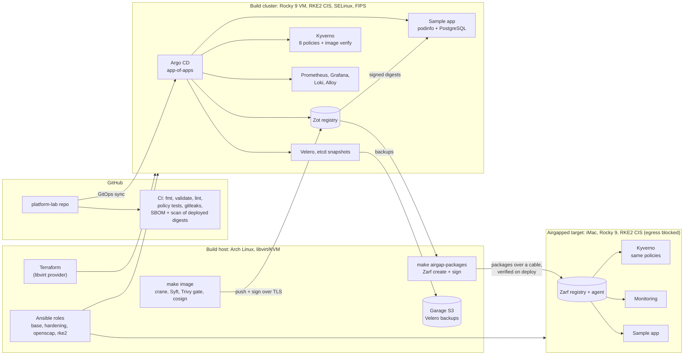
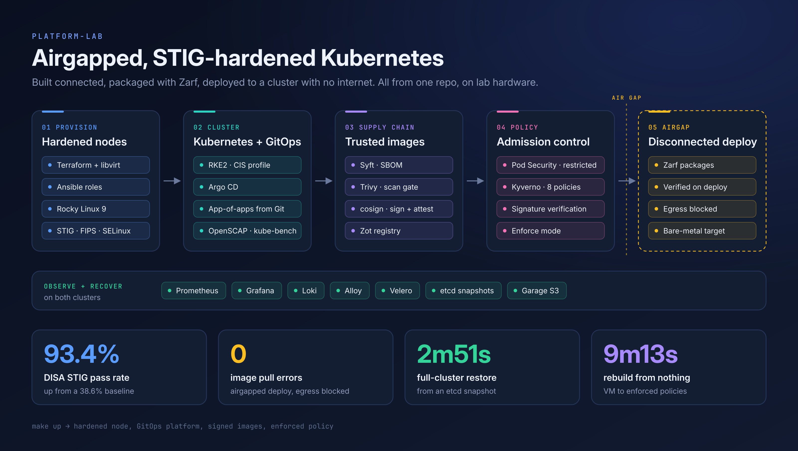
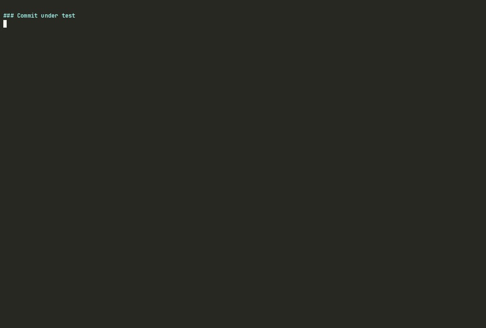

# platform-lab

An airgapped, DISA STIG-hardened Kubernetes platform, built from scratch on
personal lab hardware.

The platform is built and tested on a connected build cluster, packaged with
[Zarf](https://zarf.dev), and deployed to a second cluster that has no
internet access. Everything is reproducible from this repo: VMs come from
Terraform, every OS and cluster setting comes from Ansible, cluster add-ons
and policies come from Git through Argo CD, and nothing is configured by hand.

[](https://github.com/JGGHalfhide/platform-lab/actions/workflows/ci.yml)
[](https://github.com/JGGHalfhide/platform-lab/actions/workflows/supply-chain.yml)

## Architecture





| Layer | Tooling |
|---|---|
| Provisioning | Terraform ([dmacvicar/libvirt](https://github.com/dmacvicar/terraform-provider-libvirt)), cloud-init, Ansible |
| OS | Rocky Linux 9, SELinux enforcing, FIPS mode, firewalld on, DISA STIG hardening |
| Kubernetes | RKE2 v1.36.5 with the CIS profile |
| Compliance | OpenSCAP (RHEL 9 STIG profile), kube-bench (RKE2 CIS 1.9) |
| GitOps | Argo CD v3.6.1 (app-of-apps) |
| Registry and supply chain | Zot, crane, Syft (SBOM), Trivy (scan gate), cosign (signatures and SBOM attestations) |
| Policy | Pod Security admission (`restricted`), Kyverno v1.19.2 (CEL policies, image signature verification) |
| Airgap | Zarf v0.89.0 |
| Observability | kube-prometheus-stack, Loki, Alloy |
| Recovery | RKE2 etcd snapshots, Velero with a Garage S3 store |

Every choice has a decision record in [docs/adr/](docs/adr/). The full stack,
with versions and the end-to-end workflow, is in [docs/stack.md](docs/stack.md).

## Measured results

| Measure | Result | Source |
|---|---|---|
| DISA STIG scan (OpenSCAP, RHEL 9 STIG profile) | 38.6% → **93.4%** pass (164 → 399 rules); high-severity fails 11 → 1 | [hardening.md](docs/hardening.md) |
| Remaining STIG fails | 28 on the bare node, 29 with the platform running: each a documented exception with a reason | [hardening.md](docs/hardening.md#exceptions) |
| kube-bench (RKE2 CIS 1.9) | 81 pass / **0 fail** before and after OS hardening; 80 / 1 with the full platform (the one fail is Argo CD's wildcard RBAC, documented) | [kube-bench.md](docs/kube-bench.md) |
| Admission policy | 8 Kyverno validation policies plus image signature verification, all in Enforce; 119 offline test cases (`make policy-test`); non-compliant pods rejected with readable messages | [policy-map.md](docs/policy-map.md), [week5-enforce-test.txt](docs/scans/week5-enforce-test.txt) |
| Supply chain | Signed image admitted, unsigned and tag-only references rejected; `nginx:1.25.0` blocked by the scan gate (7 fixable CRITICAL) | [supply-chain.md](docs/supply-chain.md) |
| Rebuild from nothing (`make down && make up`) | 4m34s to a Ready node (Week 1); 7m20s hardened (Week 2); **9m13s** with Argo CD, registry and the policy set enforcing (Week 5); **8m18s** from a fresh clone with the full stack incl. monitoring and Velero (Week 8) | [ROADMAP.md](ROADMAP.md) |
| Idempotency | Second Ansible run reports `changed=0` (both clusters, airgap deploy included) | |
| Airgapped deploy (iMac, egress blocked) | `make airgap-up` 9m54s; `make airgap-deploy` 11m20s; **0 image pull errors**; policy reports 193 pass / 0 fail; unsigned image rejected | [airgap-runbook.md](docs/airgap-runbook.md#results) |
| Observability | 13/13 scrape targets up and dashboards with data on both clusters | [observability.md](docs/observability.md) |
| Restore: whole cluster from an etcd snapshot | RTO **2m51s** with `make etcd-restore` (node Ready 105 s, pods 166 s) | [recovery.md](docs/recovery.md) |
| Restore: one namespace with Velero | backup 20 s, restore **22 s**, data verified | [recovery.md](docs/recovery.md#velero) |

Scan reports are in [docs/scans/](docs/scans/) (OpenSCAP reports are gzipped
HTML and XCCDF XML).

## Demo



The GIF is sped up (the build section most; the real `make up` time, 498 s, is
printed in it). [`docs/demo.cast`](docs/demo.cast) is the full terminal
recording of `make up` from a fresh clone through a signed image publish and
three admission checks (signed pod admitted, unsigned pod and upstream
`nginx:latest` rejected). Play it with `asciinema play docs/demo.cast`; it was
recorded by [`scripts/demo.sh`](scripts/demo.sh) (`SKIP_UP=1` runs only the
policy part).

## Quickstart

This rebuilds the connected build cluster. The airgapped target is covered in
[docs/airgap-runbook.md](docs/airgap-runbook.md).

### Prerequisites

On the build host (Arch Linux here; any Linux with libvirt should do):

- libvirt with QEMU/KVM on `qemu:///system`, the `default` network active
- Terraform 1.15+, ansible-core 2.16+ (ansible-lint for development), kubectl
- For `make image`: crane, Syft, Trivy, cosign. For `make policy-test`: the
  Kyverno CLI. For the airgap targets: Zarf.
- About 12 GiB of free RAM and 80 GiB of disk for the build VM
- An ECDSA P-384 SSH key (FIPS mode rejects ed25519):

  ```
  ssh-keygen -t ecdsa -b 384 -f ~/.ssh/platform-lab_ecdsa
  ```

`make host` (run by `make up`) uses passwordless sudo once to reserve the
node's DHCP address and add `registry.platform-lab.internal` to `/etc/hosts`.

### Secrets

Secrets are in Ansible Vault at `ansible/group_vars/all/vault.yml`, decrypted
with the key at `~/.config/platform-lab/vault-pass` (back it up: without it
nothing runs). A fork needs its own vault and key:

```
mkdir -p ~/.config/platform-lab && openssl rand -base64 32 > ~/.config/platform-lab/vault-pass
chmod 600 ~/.config/platform-lab/vault-pass
ansible-vault create ansible/group_vars/all/vault.yml   # overwrite the committed one
```

| Variable | Used by | Value |
|---|---|---|
| `vault_admin_password`, `vault_admin_password_hash` | `hardening` (admin sudo password) | password; `openssl passwd -6` hash of it |
| `vault_grub_password`, `vault_grub_password_pbkdf2` | `hardening` (boot loader) | password; `grub2-mkpasswd-pbkdf2` hash of it |
| `vault_zot_admin_password`, `vault_zot_htpasswd` | `registry_auth`, `make image` | password; `htpasswd -nbB admin <password>` |
| `vault_lab_ca_key`, `vault_registry_tls_key`, `vault_registry_tls_crt` | `registry_auth` | written by `scripts/lab-pki.sh` |
| `vault_cosign_password` | `make image`, `make airgap-packages` | written by `scripts/cosign-keygen.sh` |
| `vault_argocd_redis_password` | `argocd_redis_auth` | random string |
| `vault_grafana_admin_password` | `grafana_admin` | random string |
| `vault_sample_db_password` | `sample_app_secret` | random string |
| `vault_velero_repo_password` | `velero_secrets` (Kopia repository encryption) | random string |
| `vault_velero_s3_key_id`, `vault_velero_s3_secret` | `velero_secrets`, `make backup-store` | Garage key (`GK` + 24 hex), 64 hex secret |
| `vault_garage_rpc_secret`, `vault_garage_admin_token`, `vault_garage_metrics_token` | `make backup-store` | `openssl rand -hex 32` each |

In a fork, also:

1. Run `scripts/lab-pki.sh` (new lab CA in `pki/lab-ca.crt`) and
   `scripts/cosign-keygen.sh` (new `pki/cosign.pub`), then paste the new
   public key into `gitops/policies/verify-platform-images.yaml`.
2. Point Argo CD at the fork: replace the `repoURL` in `gitops/root.yaml`
   and `gitops/apps/*.yaml`.

### Build, check, tear down

```
make up           # host setup, VM, Ansible (base, hardening, OpenSCAP, RKE2, secrets), Argo CD
make verify       # kubectl get nodes against ./kubeconfig

# The registry starts empty: publish the images the manifests pin, by
# tag@digest (a tag alone can move upstream: postgres had by 11/23).
make image IMAGE=docker.io/stefanprodan/podinfo:6.17.0@sha256:fa2f27c1a8561097e5144bfc0853eba6054d743b68b03de4cad4675616ddefb0
make image IMAGE=docker.io/library/postgres:17.12-alpine3.24@sha256:a77aa70e641402a21411b92b721c58d10f23b50ae5fdd2333efd22d166e1e5f7
make image IMAGE=docker.io/velero/velero:v1.18.4@sha256:c89fb5b6d1fd6afd368e0f483e6f5555fd62851a1eada8ac5c72482e674ca17b
# KEDA and its HTTP add-on (gitops/keda)
make image IMAGE=ghcr.io/kedacore/keda:2.21.1@sha256:d09d92c0a310e3057a3c54df387b99abf2bf31352218dbe1adcb00e807886488
make image IMAGE=ghcr.io/kedacore/keda-metrics-apiserver:2.21.1@sha256:747e376b3e80dc4f72bf4f7043f47cc4cdb56f34b1aed9531789f474996e1c84
make image IMAGE=ghcr.io/kedacore/keda-admission-webhooks:2.21.1@sha256:5f4b0b0f7831b9f53738be85e99449a1747a5effa970305fe602455ab0f4fcd3
make image IMAGE=ghcr.io/kedacore/http-add-on-operator:0.16.0@sha256:2ae0076d549fb7d12b3d9ecb1e87d035c7ee73e94a640ff53842e70ab0824da0
make image IMAGE=ghcr.io/kedacore/http-add-on-interceptor:0.16.0@sha256:3a9a454b949edd5dee711ed14e603cc3b91b7c065905ecc251fe0a56a4c026f1
make image IMAGE=ghcr.io/kedacore/http-add-on-scaler:0.16.0@sha256:db5223b1a37521ec0f099ac04785bfc069f5c3ebf4bacffd04e5127b0876dffb

make policy-test                      # Kyverno policy tests, offline
make stig-scan NAME=my-scan           # OpenSCAP STIG scan -> docs/scans/my-scan.*
make bench OUT=docs/scans/kb.txt      # kube-bench Job, report saved, Job removed
make backup-store                     # Garage S3 store for Velero (optional)

make down         # destroys the VM (keeps the base image)
```

`make up` is safe to rerun: the playbook is idempotent. Secrets, kubeconfigs
and Terraform state never go into the repo. In Claude Code or other
non-interactive shells, run Ansible with `</dev/null`.

### Airgap, recovery

```
make airgap-stage && make airgap-packages   # build host, connected
make airgap-up && make airgap-disconnect && make airgap-deploy
make etcd-snapshot SNAPSHOT=<name>
make etcd-restore SNAPSHOT=<name> CONFIRM=yes
```

Step by step: [docs/airgap-runbook.md](docs/airgap-runbook.md),
[docs/recovery.md](docs/recovery.md).

## Repository layout

```
terraform/          libvirt VMs (modules/rocky-vm) and cloud-init
ansible/            playbooks and roles, one role per concern
  roles/base          packages, time sync, firewalld, NetworkManager, SELinux
  roles/hardening     DISA STIG hardening, with documented exceptions
  roles/openscap      scanner install and STIG scan tasks
  roles/rke2          RKE2 with the CIS profile (online or from staged artifacts)
  roles/zarf          Zarf init and package deploy on the airgapped node
  roles/airgap_egress firewalld policies that block egress
  roles/*_secrets, registry_auth, argocd_redis_auth, grafana_admin
                      Kubernetes Secrets from Ansible Vault
gitops/             Argo CD root and apps, Kyverno policies and exceptions,
                    chart values, dashboards, sample app
zarf/               airgap packages: platform, policies, sample-app, monitoring
tests/policies/     kyverno test cases (generated by generate.py)
scripts/            host bootstrap, image publishing, PKI and cosign keys,
                    airgap staging and link, backup store, kube-bench
pki/                lab CA certificate and cosign public key
docs/               write-ups, ADRs, scan reports
.github/workflows/  CI and the supply-chain scan
Makefile            every entry point
```

## Hardware

- Build host: mini PC, Ryzen 7 8845HS, 32 GB RAM, Arch Linux
- Disconnected target: older iMac, Core i5-4570R, 8 GB RAM, Rocky Linux 9
- Development: a laptop with SSH to the build host

## License

[MIT](LICENSE)
