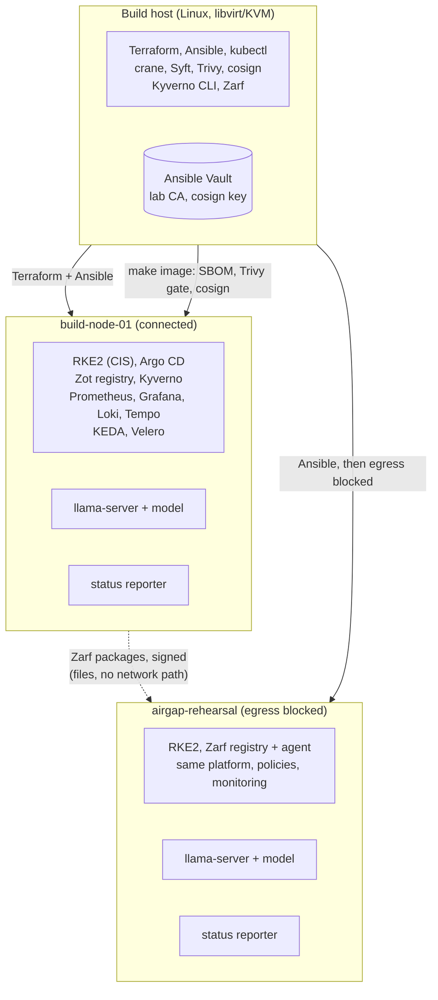
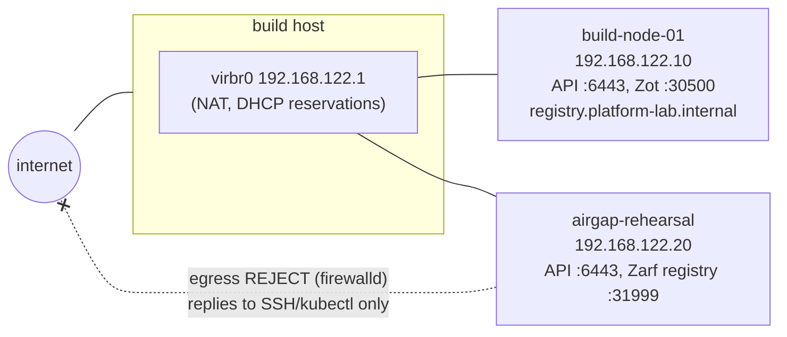

# Build guide: from bare hardware to an AI agent on an airgapped cluster

One path through three repos, starting from an empty machine:

| Part | Repo | You end with |
|---|---|---|
| 1 | [platform-lab](https://github.com/JGGHalfhide/platform-lab) | A hardened single-node Kubernetes cluster with GitOps, a signing supply chain, admission policies, monitoring and tracing; optionally its airgapped twin. **A complete lab on its own: stop here if the platform is all you want.** |
| 2 | [local-airgap-LLM](https://github.com/JGGHalfhide/local-airgap-LLM) | A CPU-only LLM endpoint (Qwen3.5 4B on llama.cpp) inside the cluster, OpenAI-compatible, scaled to zero when idle, the model shipped as a signed image |
| 3 | [local-agents](https://github.com/JGGHalfhide/local-agents) | A read-only status-reporting agent using that endpoint, traced, with an API, a CLI and a web view, scored by fault injection |
| 4 | all three | The same stack on a disconnected cluster with egress blocked |

Each step says what to run, what it does, and what you should see. The
details live in each repo's docs (linked); this guide puts them in order.
Numbers quoted as "measured" come from those repos' committed scans and
results.

## What you are building



Network (libvirt's default NAT network; the two VMs never run at the same
time on a 32 GB host):



Inside the cluster, a status report flows: operator or CronJob
(`agentctl`) -> agent API (one run at a time) -> read-only Kubernetes API
calls (the agent's ServiceAccount: get/list/watch only) and chat requests to
the endpoint through the KEDA HTTP interceptor (NetworkPolicy admits only
labelled agent pods; the model scales up from zero in about 6 s) -> a
report checked against what the tools showed -> stored and returned; every
model and tool call is a span in Tempo (metadata only).

## Hardware and host

Measured on: a mini PC with a Ryzen 7 8845HS (8 cores / 16 threads,
AVX-512), 32 GB RAM (about 28 GiB usable), a 1 TB NVMe, Arch Linux. Each VM
is 12 vCPU / 20 GiB / 39 GiB disk, one at a time.

Minimums: x86-64 with hardware virtualisation, 32 GB RAM (one VM of 20 GiB
plus the host), about 120 GB free disk (VM images, packages, a 2.8 GiB
model). The LLM is CPU-only: more cores and AVX-512 mean more tokens per
second (measured here: 14.3 tok/s for one stream).

### Host software

Versions this guide was run with. Arch packages are named; any Linux with
the same tools should work. Verify downloaded binaries against their
release checksums.

| Tool | Version | Source | Used for |
|---|---|---|---|
| libvirt, QEMU/KVM | 12.9.0, 11.1.3 | `libvirt`, `qemu-full` | the VMs, at `qemu:///system`, `default` network active |
| Terraform | 1.15.9 | `terraform` | VMs and volumes |
| Ansible | ansible-core 2.22.0 | `ansible-core`, `ansible` | OS hardening, RKE2, secrets, airgap deploy |
| kubectl | 1.37.2 | `kubectl` | everything in the clusters |
| crane | 0.22.1 | `crane` | image copy and the agent's image build |
| Syft | 1.55.0 | `syft` | SBOMs |
| Trivy | 0.76.2 | `trivy` | the vulnerability gate |
| cosign | 3.1.3 | `cosign` | signatures and attestations |
| Kyverno CLI | 1.19.2 | release binary (sha256 `dd492a23...eea8` here) | `make policy-test` |
| Zarf | v0.89.0 | release binary (sha256 `0d085973...6110` here); `scripts/airgap-stage.sh` downloads and checks it for the node | airgap packages |
| Python | 3.14 | `python` | scripts, the agent's tooling |
| yamllint | 1.38.0 | `yamllint` | linting |
| asciinema, agg | 3.2.1, 1.9.0 | `asciinema`; agg release binary | recordings (optional) |

## Part 1: the lab (platform-lab only)

Everything in this part is platform-lab's own
[README quickstart](../README.md#quickstart); it works with no other repo.

1. **SSH key** (FIPS mode on the nodes rejects ed25519):

   ```bash
   ssh-keygen -t ecdsa -b 384 -f ~/.ssh/platform-lab_ecdsa
   ```

2. **Clone** platform-lab (and, for later parts, the other two next to it:
   `~/projects/{platform-lab,local-airgap-LLM,local-agents}`).

3. **Secrets, CA and signing key** (a fork starts with its own): create the
   vault key and vault, then the lab CA and the cosign key pair, and point
   the image-verification policy and Argo CD at your fork. The variables
   and commands are listed in the README's
   [Secrets](../README.md#secrets) section; `scripts/lab-pki.sh` and
   `scripts/cosign-keygen.sh` write their values into the vault. Back up
   `~/.config/platform-lab/vault-pass`: without it nothing runs.

4. **Build the cluster:**

   ```bash
   make up        # host setup (one sudo: DHCP reservation, /etc/hosts), VM, Ansible, Argo CD
   make verify    # the node is Ready
   ```

   Measured: 498 s from a fresh clone. A second `make up` reports
   `changed=0`. If anything fails, rerun: the playbook is idempotent. In
   non-interactive shells run Ansible with `</dev/null`.

5. **Wait for the cluster to settle** after any VM boot: etcd and the API
   server restart a few times while RKE2 comes up. Continue when they have
   gone 2 minutes without a restart
   (`kubectl -n kube-system get pods | grep -E 'etcd|apiserver'`).

6. **Publish the images the manifests pin** (the registry starts empty).
   Every image goes through `make image`: SBOM, Trivy gate (no fixable
   CRITICAL), cosign signature with your key; Kyverno admits only signed
   images from the lab registry. Always by tag@digest. The list is in the
   README's [Build, check, tear down](../README.md#build-check-tear-down).

7. **Check the platform:**

   ```bash
   make policy-test                     # Kyverno policy tests, offline: all pass
   kubectl -n argocd get applications   # every Application Synced Healthy
   ```

   An unsigned image is rejected at admission; a signed one is admitted
   ([supply-chain.md](supply-chain.md)). Grafana, Prometheus, Loki and Tempo
   run in `monitoring` ([observability.md](observability.md)).

8. **Optional: the airgapped twin.** `make rehearsal` creates the second VM;
   [airgap-runbook.md](airgap-runbook.md) stages RKE2 and Zarf, installs the
   node, blocks its egress and deploys the platform as signed Zarf packages.
   Switch VMs with `make vm-stop VM=<name>` and `make vm-start VM=<name>`
   (never `virsh start`: the guard checks memory and the other VM).

**Checkpoint: you have the lab.** A hardened, GitOps-managed cluster with a
signing supply chain, admission policies and observability, and the means
to carry it to a disconnected node. Stop here if that is what you need.

## Part 2: the model endpoint (local-airgap-LLM)

Needs Part 1 (build cluster up). platform-lab's root Argo CD app already
includes this repo's `deploy/`.

1. **Publish the runtime and test image** (from platform-lab):

   ```bash
   make image IMAGE=ghcr.io/ggml-org/llama.cpp:server-v1.0.0-b12359-b1b770d@sha256:e3032ea0712da96dec820c770626385de4322dd06619fb5829256a504bbc9375
   make image IMAGE=docker.io/library/alpine:3.22@sha256:49340b346798875b5592e5d420241f2f9cfba5f47e62ebb1446a1b34734e898f
   ```

   and the KEDA images listed in local-airgap-LLM's
   [quickstart](https://github.com/JGGHalfhide/local-airgap-LLM#quickstart).

2. **The model as a signed image** (in local-airgap-LLM):

   ```bash
   make model
   ```

   Downloads `Qwen3.5-4B-Q4_K_M.gguf` from `ggml-org/Qwen3.5-4B-GGUF` at
   revision `8d43d974efc48399cb58957ad49c8b26bf5a109c`, checks SHA-256
   `217002fa8008ef4fc6d548353a3aebef055a96e6ff8e0e2c0953ef8254a89c14`
   (license Apache-2.0), builds a deterministic one-layer OCI image and
   signs it with SLSA provenance. Expected digest:
   `models/qwen3.5-4b-q4km:hf-8d43d974efc4@sha256:fb1e513b...`.

3. **Test the endpoint:**

   ```bash
   export KUBECONFIG=../platform-lab/kubeconfig
   make smoke      # completion, NetworkPolicy, no egress, unsigned model rejected: 7/7
   ```

   The endpoint is `http://llm-api.llm.svc:8080` inside the cluster,
   OpenAI-compatible, 4 parallel slots, thinking off by default. Only pods
   labelled `inference.local-airgap-llm/client: "true"`, in a namespace with
   the same label, can reach it.

## Part 3: the agent (local-agents)

Needs Parts 1 and 2. platform-lab's root app includes the Application
`local-agents` (namespace `agents`).

1. **Build and publish the agent image** (reproducible: the same commit
   gives the same digest):

   ```bash
   cd ../local-agents
   make agent-image
   make -C ../platform-lab image IMAGE=oci-layout:$PWD/build/agent-image/oci \
     NAME=local-agents/agent:$(git rev-parse --short HEAD)
   ```

   Pin the printed digest in `deploy/agents/status-reporter.yaml` (a fork
   commits it; Argo CD syncs `deploy/`). To rebuild the image the repo
   already pins (after a rebuild, the registry is empty), build at the
   commit named in that file instead of HEAD (`git checkout <commit>`
   first): the digest includes the commit, and the result must equal the
   pinned digest byte for byte.

2. **Run a status report:**

   ```bash
   kubectl -n agents port-forward svc/status-reporter 8080:8080 &
   python3 agent/agentctl.py status      # exit 0 healthy, 1 fault, 2 unknown, 3 busy
   ```

   Open http://localhost:8080/ for the read-only web view. Expected: a
   report in about 50 s; on a healthy cluster `HEALTHY` with no findings.

3. **Score it** by fault injection (disposable `agent-eval-*` namespaces;
   read [eval-status.md](https://github.com/JGGHalfhide/local-agents/blob/main/docs/eval-status.md)
   first):

   ```bash
   eval/status/run_eval.py results/my-run
   ```

   Measured: 8/8 faults, 5/5 healthy controls, no false findings, median
   about 49 s per run.

4. **Traces:** Grafana, Explore, datasource Tempo, or the dashboard
   "Status reporter (local-agents)" in the platform-lab folder.

## Part 4: the airgapped cluster

Needs Parts 1-3 and the airgapped twin from Part 1, step 8. Packages are
built while the build VM runs, then the VMs are switched.

```bash
# build VM running: build and sign every package
cd ../platform-lab   && make airgap-packages
cd ../local-airgap-LLM && make airgap-packages
cd ../local-agents   && make airgap-packages

# switch VMs, let the node settle, then deploy everything (egress blocked)
cd ../platform-lab && make vm-stop VM=build-node-01 && make vm-start VM=airgap-rehearsal
cd ../local-agents && make airgap-deploy
```

`make airgap-deploy` runs platform-lab's Zarf role: platform-lab's packages,
then the endpoint's, then the agent's, each verified against your cosign
key. Then check: egress blocked, every Zarf component `Succeeded`, no image
pull errors from the deploy, an unsigned image rejected, a status run and
its trace. The same eval runs there (measured: 8/8, 5/5, median 48 s). Full
steps and results:
[local-agents airgap-runbook](https://github.com/JGGHalfhide/local-agents/blob/main/docs/airgap-runbook.md).

## Things that will bite you

- **One VM at a time.** Two 20 GiB VMs do not fit in 32 GB; `vm-start`
  refuses while the other runs.
- **Let a booted cluster settle** before deploying or testing (Part 1,
  step 5). After a boot, components that start before Kyverno or the
  registry log failures that recover seconds later.
- **The registry starts empty after a rebuild:** republish every image by
  tag@digest; a tag alone can move upstream. Argo CD deploys before the
  images are there, so Kyverno logs `evaluation error` PolicyViolation
  events for those minutes (145 in the v1.0 rebuild). They stop once the
  images exist and expire within an hour; wait for that before evaluating
  the agent, or it reports them.
- **A freshly booted node needs time before you judge it.** System pods
  restart once while it boots and a CPU-only model is slower for about 20
  minutes. The agent treats earlier restarts as history only after 10
  minutes of running, so its eval waits until no restarted container has
  run for less than that.
- **`zarf init` cannot be re-run** on the airgapped node once the Kyverno
  policies are there; an interrupted init means a fresh VM.
- **Bump a Zarf package's version in two places:** its `zarf.yaml` and
  platform-lab's `ansible/roles/zarf/defaults/main.yml`. A package built
  from a kustomization goes stale when its sources change.
- **The agent's API runs one report at a time;** its hourly CronJob holds
  it for about a minute at the top of the hour.

## Where everything is

| Topic | Doc |
|---|---|
| Every component, version and why | stack.md in [platform-lab](stack.md), [local-airgap-LLM](https://github.com/JGGHalfhide/local-airgap-LLM/blob/main/docs/stack.md), [local-agents](https://github.com/JGGHalfhide/local-agents/blob/main/docs/stack.md) |
| Decisions | `docs/adr/` in each repo |
| Hardening, CIS and STIG | [hardening.md](hardening.md), [kube-bench.md](kube-bench.md) |
| Supply chain and policies | [supply-chain.md](supply-chain.md), [policy-map.md](policy-map.md) |
| Backup and restore | [recovery.md](recovery.md) |
| Airgap | airgap-runbook.md in each repo |
| Measured results | each repo's README and [local-agents results](https://github.com/JGGHalfhide/local-agents/blob/main/docs/results.md) |
