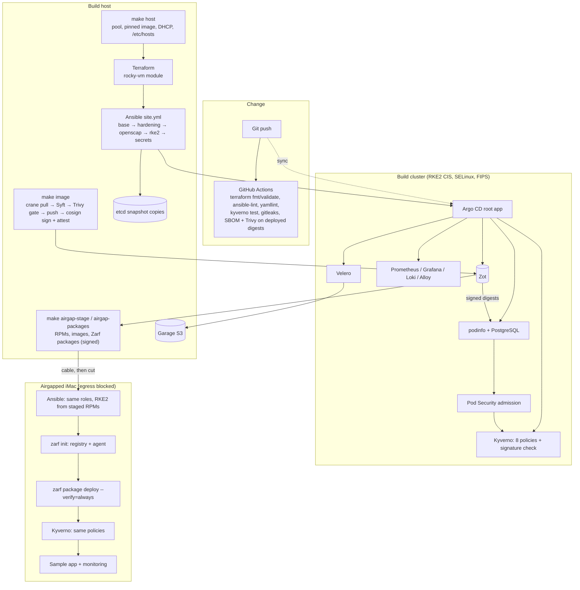

# Stack and workflow

The full technical specification of platform-lab: every tool and component,
its version, what it does here and why it was chosen, then the end-to-end
workflow from an empty host to a restored cluster, and a diagram.
Decisions are recorded in [adr/](adr/); results in the
[README](../README.md#measured-results).

## Tech stack

### Hardware and host

| Component | Version | What it does here | Why |
|---|---|---|---|
| Build host | Ryzen 7 8845HS, 32 GB, Arch Linux | Runs the build cluster VMs, the publishing tools, the Zarf builds and the backup store | Personal hardware; enough RAM for a 12 GiB VM plus tooling |
| libvirt / QEMU / KVM | system (`qemu:///system`) | Hypervisor for the build node and the airgap rehearsal VM | Native on Linux, scriptable, supported by a Terraform provider |
| Airgapped target | iMac, i5-4570R, 8 GB, Rocky Linux 9.9 | Second cluster with egress blocked; receives everything as files | Real, separate bare metal: proves the airgap path end to end |
| Direct link | build host `eno1` ↔ iMac, 192.168.50.0/24 | NetworkManager `shared` while connected; cut with an nft table (`make airgap-link-cut`) | Keeps the target off the home LAN; one cable carries both setup and the package transfer |

### Provisioning

| Component | Version | What it does here | Why |
|---|---|---|---|
| Terraform | 1.15 | Creates the VMs from the shared `modules/rocky-vm` module; outputs the node IPs | Declarative, plan before apply, state outside the repo ([ADR 0004](adr/0004-terraform-libvirt-and-ansible.md)) |
| dmacvicar/libvirt provider | 0.9.9 | Volumes, cloud-init disks, domains with fixed MACs | The maintained libvirt provider |
| cloud-init | Rocky GenericCloud image | User, SSH key and nothing else | Everything else belongs to Ansible, so the iMac (no cloud-init) gets the same setup |
| Ansible | ansible-core 2.16+ (2.22 used), ansible-lint | All OS and cluster configuration, one role per concern, `changed=0` on a second run | Agentless over SSH, works on the VM and the bare-metal target alike |
| Ansible Vault | | Every secret (passwords, hashes, TLS keys, tokens); key outside the repo | Secrets versioned with the code, encrypted at rest |
| `scripts/host-bootstrap.sh` | | Default storage pool, pinned Rocky image verified against its published SHA-256, DHCP reservation, `/etc/hosts` entry | The only host changes, scripted and idempotent |

### Operating system

| Component | Version | What it does here | Why |
|---|---|---|---|
| Rocky Linux 9 | 9.8 image (VMs), 9.9 (iMac) | Guest and target OS | Has a DISA STIG profile in scap-security-guide and EL packages for `rke2-selinux` ([ADR 0002](adr/0002-rocky-linux-9.md)) |
| SELinux | enforcing | Confines containers (`container_t`, MCS categories); a few workloads run `spc_t` | STIG requirement; RKE2 supports it |
| FIPS mode | `FIPS:STIG` crypto policy | Kernel and OpenSSL in FIPS mode | STIG requirement; also why the lab SSH key is ECDSA P-384 |
| firewalld | system | Host firewall with RKE2 ports open and pod/service CIDRs trusted; egress policies on the target | STIG requires an active host firewall ([ADR 0003](adr/0003-firewalld-stays-on.md)) |
| `hardening` role | | SSH, PAM/authselect, audit rules, kernel parameters, GRUB password, AIDE, banner, session timeout; 28 documented exceptions | Turns the 38.6% baseline into 93.4% ([hardening.md](hardening.md)) |

### Kubernetes

| Component | Version | What it does here | Why |
|---|---|---|---|
| RKE2 | v1.36.5+rke2r1 (versionlocked) | Single-node cluster on each machine | CIS profile built in, SELinux policy, RPM and airgap installs ([ADR 0001](adr/0001-rke2-with-cis-profile.md)) |
| RKE2 CIS profile | `profile: cis` | Pod Security admission at `restricted`, audit policy, Secrets encryption, protected kernel defaults, `etcd` user | Covers most CIS and Kubernetes STIG controls without custom flags |
| Canal | bundled | CNI (Flannel + Calico policy) | RKE2 default; NetworkPolicy support |
| Traefik | bundled | Ingress for the registry (`registry.platform-lab.internal`, TLS from the lab CA) | RKE2's bundled ingress controller |
| local-path-provisioner | v0.0.37 | Default StorageClass (`local` volumes) for Zot, Prometheus, Loki, PostgreSQL | Small and simple for single-node clusters; the only option that needs no extra storage system |

### GitOps

| Component | Version | What it does here | Why |
|---|---|---|---|
| Argo CD | v3.6.1 | Installed once by `make argocd`, then manages itself and every app under `gitops/apps/` from the root Application | Declarative sync from Git with a UI and health checks ([ADR 0005](adr/0005-argo-cd-app-of-apps.md)) |
| Kustomize | built into kubectl and Argo CD | Pinned upstream manifests plus local patches (resources, projected tokens, Redis credentials from a file) | Patches upstream without forking it |

### Registry and supply chain

| Component | Version | What it does here | Why |
|---|---|---|---|
| Zot | v2.1.23 (chart 0.1.134) | In-cluster OCI registry; anonymous read, `admin` push; NodePort 30500 for the node, TLS ingress for the host | Single binary, OCI-native, small ([ADR 0006](adr/0006-zot-registry.md)) |
| Lab CA | ECDSA P-384 (`scripts/lab-pki.sh`) | Signs the registry's TLS certificate; trusted through `SSL_CERT_FILE` only | No system-wide trust changes on the host |
| crane | go-containerregistry | Resolves digests, pulls whole indexes (all platforms) as OCI layouts, pushes with the digest unchanged | Byte-for-byte copies, so the upstream digest is the deployed digest |
| Syft | 1.55.0 | SPDX 2.3 and CycloneDX SBOMs per image | Standard formats; SPDX is attached as an attestation |
| Trivy | 0.76.2 | Vulnerability scan and the gate: fail on any fixable CRITICAL; exceptions in `.trivyignore.yaml` with a statement each | Fast, offline-capable DB, path-scoped ignores |
| cosign | v3.1.3 | Signs the index digest and attaches the SBOM attestation with a local key pair; no Rekor; tag-based `.sig`/`.att` | Verifiable offline, format supported by Kyverno and Zarf ([ADR 0007](adr/0007-supply-chain-signing.md)) |
| GitHub Actions | `.github/workflows/` | CI (fmt, validate, lint, policy tests, gitleaks) and the supply-chain scan of deployed digests | Checks every change without the lab |
| gitleaks | 8.30.1 | Secret scan of the full history in CI | Catches committed secrets that Vault would have prevented |

### Policy and compliance

| Component | Version | What it does here | Why |
|---|---|---|---|
| Pod Security admission | built in | `restricted` on every namespace except RKE2's own and three scoped `privileged` ones | First layer, enforced by the API server ([policy-map.md](policy-map.md)) |
| Kyverno | v1.19.2 (chart 3.9.2) | Eight `ValidatingPolicy` rules (privileged, hostPath, PSS restricted, latest tag, resources, labels, trusted registries, Secrets in env) and an `ImageValidatingPolicy` for signatures; all Enforce | Native cosign verification, CEL policies, PolicyReports ([ADR 0008](adr/0008-kyverno-policy-engine.md)) |
| Kyverno CLI | v1.19.2 | `make policy-test`: 119 offline cases generated by `tests/policies/generate.py` | Policies tested like code, in CI too |
| OpenSCAP / scap-security-guide | Rocky 9 packages | `make stig-scan`: RHEL 9 DISA STIG profile on the node, HTML and XCCDF reports | The reference STIG scanner for EL |
| kube-bench | RKE2 CIS 1.9 profile | `make bench`: one-shot Job, report saved, Job removed | Standard CIS benchmark check for Kubernetes |

### Airgap

| Component | Version | What it does here | Why |
|---|---|---|---|
| Zarf | v0.89.0 | Builds signed packages (platform, policies, sample-app, monitoring) on the connected host; `zarf init` provides the target registry (NodePort 31999) and the agent that rewrites image references | Declarative airgap packaging with signature verification on deploy ([ADR 0009](adr/0009-zarf-airgap-packaging.md)) |
| Staged RKE2 artifacts | `make airgap-stage` | RKE2 RPMs and images tarball, local-path bootstrap, Zarf CLI and init package, all checksummed | Same RPM layout and SELinux policy as the build node |
| `airgap_egress` role | firewalld policies | Blocks node and pod egress beyond the link | Proves the deploy needs nothing from the internet |

### Observability

| Component | Version | What it does here | Why |
|---|---|---|---|
| kube-prometheus-stack | 92.17.0 (Prometheus v3.15.1) | Prometheus, operator, kube-state-metrics (also PolicyReport metrics), node-exporter; 13 targets incl. etcd | The standard bundle, one chart ([ADR 0010](adr/0010-observability-stack.md)) |
| Grafana | 13.3.0 (subchart) | Dashboards for node, etcd and policy reports from `gitops/monitoring/dashboards/`; admin password from Vault via a file | Dashboards as code |
| Loki | 3.6.11 (chart 7.5.0) | Log store, single binary on a filesystem volume, 7 days | Smallest Loki mode, fits 8 GB |
| Alloy | v1.21.3 (chart 1.15.0) | Pod logs and Kubernetes events through the API, no `hostPath` | Promtail is end-of-life; API collection avoids host access |

### Recovery

| Component | Version | What it does here | Why |
|---|---|---|---|
| RKE2 etcd snapshots | built in | Every 6 hours, 12 kept; on-demand copies on the host; `make etcd-restore` (RTO 2m51s) | Whole-cluster restore with no extra component ([ADR 0011](adr/0011-backup-and-restore.md)) |
| Velero | v1.18.4 (chart 12.2.2) | Namespace backups with Kopia file-system backup; restore 22 s | Application-level backup and restore, data included |
| Garage | 2.5.0 (Arch package) | S3 store for Velero on the build host, bound to the libvirt bridge | Survives the cluster; single binary; MinIO stopped publishing community builds |

### Sample application

| Component | Version | What it does here |
|---|---|---|
| podinfo | 6.17.0 | Small web app |
| PostgreSQL | 17.12 (alpine) | Database with a local-path volume; password from Vault |

Both run from the platform registry, pinned by digest and signed.

## Workflow

### 1. Host and VM: `make up`

1. `make host`: storage pool, Rocky 9 GenericCloud image (pinned, SHA-256
   checked), DHCP reservation for the node's fixed MAC, `/etc/hosts` entry
   for the registry.
2. `terraform apply`: the `build-node-01` VM (12 GiB) with cloud-init (user
   and SSH key only).
3. `make inventory`: Ansible inventory from `terraform output`.
4. `ansible-playbook site.yml --limit build_servers`:
   - `base`: updates, chrony, firewalld with RKE2 ports and trusted CIDRs,
     NetworkManager CNI exclusions, SELinux enforcing.
   - `hardening`: FIPS (reboot), SSH, PAM, audit, kernel, GRUB, AIDE;
     sudo password and GRUB password from Vault.
   - `openscap`: scanner installed for `make stig-scan`.
   - `rke2`: pinned RKE2 with the CIS profile, CIS sysctls, `etcd` user,
     etcd snapshot schedule; kubeconfig fetched to `./kubeconfig`.
   - Secret roles: registry htpasswd and TLS, Argo CD Redis, Grafana admin,
     sample DB, Velero credentials, all from Vault.
5. `make argocd`: Argo CD from pinned manifests plus patches, then the root
   Application. Argo CD syncs everything else from Git: local-path, Zot,
   Kyverno, policies, monitoring, Velero, sample app.

### 2. Compliance checks

- `make stig-scan NAME=...`: OpenSCAP STIG scan on the node, reports under
  `docs/scans/` (gzipped copies committed).
- `make bench OUT=...`: kube-bench Job under the enforced policies (scoped
  exceptions), report saved.

### 3. Publishing an image: `make image IMAGE=<ref>`

1. Resolve the reference to a digest; pull the whole index (all platforms)
   as an OCI layout with crane.
2. Syft: SPDX and CycloneDX SBOMs.
3. Trivy: full report, then the gate (no fixable CRITICAL, unless excepted
   in `.trivyignore.yaml`).
4. Push over TLS to `registry.platform-lab.internal` with a throwaway login;
   check the pushed digest equals upstream.
5. cosign: sign the index digest, attach the SPDX SBOM as an attestation,
   verify both against `pki/cosign.pub`.

In CI, `.github/workflows/supply-chain.yml` repeats steps 1-3 (`PUSH=0`) for
every digest pinned in `gitops/`, on change and weekly.

### 4. Admission

A pod reaches the API server and passes, in order:

1. Pod Security admission (`restricted`).
2. Kyverno `ValidatingPolicy` rules (Deny): no privileged containers, no
   hostPath, restricted controls, no `latest`, resources, labels, trusted
   registries, no Secrets in env.
3. Kyverno `verify-platform-images`: images from the platform registry must
   be pinned by digest and signed with the lab key, checked against Zot.

Anything else is rejected with the policy message (examples in
`docs/scans/week4-admission-test.txt`, `week5-enforce-test.txt`).

### 5. Airgap packaging and deploy

1. `make airgap-stage` (connected): RKE2 RPMs and images, local-path
   bootstrap, Zarf CLI and init package, with checksums.
2. `make airgap-packages` (connected): `zarf package create` for platform,
   policies, sample-app and monitoring, from the same sources as `gitops/`,
   including the cosign signature artifacts; packages signed with the lab
   key.
3. `make airgap-up`: base, hardening and RKE2 (airgap mode) on the target.
4. `make airgap-link-cut` on the host, `make airgap-disconnect` on the
   target: egress blocked, proven with failing `curl` and `dnf`.
5. `make airgap-deploy`: copy Zarf and the packages over the link,
   `zarf init`, deploy each package with `--verify=always`. The Zarf agent
   rewrites images to `127.0.0.1:31999`; Kyverno verifies signatures
   against the Zarf registry.

### 6. Observability

Prometheus scrapes 13 targets (API server, kubelet, etcd on 2381, node,
CoreDNS, Kyverno and others); Alloy ships pod logs and events to Loki;
Grafana shows the node, etcd and policy-report dashboards. Same values on
both clusters (Argo CD on the build cluster, `zarf/monitoring` on the target).

### 7. Backup and restore

- etcd: scheduled snapshots, `make etcd-snapshot SNAPSHOT=...` with a copy on
  the host; `make etcd-restore SNAPSHOT=... CONFIRM=yes` resets the cluster
  to the snapshot.
- Velero: namespace backups to Garage; restore with Argo CD paused for the
  app, so it does not recreate an empty one first.

Procedures and times: [recovery.md](recovery.md).

## Diagram

Mermaid source; GitHub renders it, and it can be pasted into any Mermaid
editor to export or redraw.

